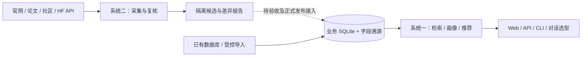

# AISHPerf — AI 芯片 × 模型知识图谱

AISHPerf 汇集芯片规格、模型元数据、兼容关系、训练/推理实测及字段来源，提供芯片查询、模型画像与算力选型。仓库包含两套系统，共用 SQLite 数据和部分基础模块，但完成程度、运行依赖与写入权限不同。

| 系统 | 交付能力 | 当前状态（2026-10-27） |
|---|---|---|
| **查询与推荐系统** | Web、FastAPI、CLI；检索、画像、显存/卡数估算、推荐、实测与溯源查询、可选对话选型 | 主体已完成；数据覆盖与特定场景性能仍需持续校准 |
| **数据采集与更新系统** | 来源巡检、HF 同步、导入工具；Hermes 六域搜索、抓取、提取、独立复核、实体匹配、比较与审计 | 开发中；V3 目前仅做隔离候选，真实六域端到端验收、正式发布及持续更新尚未闭环 |



## 一、查询与推荐系统

### 安装与数据库准备

需要 **Python 3.11+**，Docker 基础镜像使用 Python 3.13。以下命令在仓库根目录执行：

```bash
git clone https://github.com/bupt-lxc/chip-recommend.git
cd chip-recommend
python -m venv .venv
```

```powershell
# Windows PowerShell
.\.venv\Scripts\Activate.ps1
```

```bash
# Linux / macOS
source .venv/bin/activate
```

```bash
python -m pip install -r requirements.txt
python -m pip install pytest jsonschema
```

也可使用 `uv venv`、`uv pip install -r requirements.txt pytest jsonschema`。`requirements.txt` 包含 Excel 导入和 PDF 提取依赖，仅安装 `pyproject.toml` 中的依赖不足以覆盖这些功能。浏览器测试另需 `python -m pip install playwright`、`python -m playwright install chromium`。

**完整运行数据库不在 Git 中。** 将经过 SQLite 一致性备份的数据库恢复到 `data/data.db`，或设置 `DATA_DB_PATH`。当前数量通过 `python scripts/run_cli.py db status` 或 `/api/v1/db/status` 查询。

首次体验可以创建空库：

```bash
python -c "from chip_model.database import init_db; init_db()"
python scripts/run_cli.py db status
```

空库只验证基础服务，搜索结果为空。V3 会检查来源库实际列；基础 `schema.sql` 与历史完整库存在差异，例如实测表的 `citation/evidence_level/methodology/reference_url`。不能用空库代替完整采集验收库，也不要为通过检查直接修改生产库。

### 启动服务

```bash
python scripts/run_server.py
```

| 入口 | 地址 |
|---|---|
| 首页 / 系统状态 | [http://localhost:8000](http://localhost:8000) / [http://localhost:8000/status](http://localhost:8000/status) |
| Scalar 文档 / OpenAPI | [API 文档](http://localhost:8000/docs) / [OpenAPI](http://localhost:8000/openapi.json) |
| 健康检查 | [http://localhost:8000/api/v1/health](http://localhost:8000/api/v1/health) |

基础查询与推荐无需模型密钥；对话选型需 DeepSeek。启动会执行辅助表/索引的增量初始化，因此数据库目录需可写，启动前应备份已有数据。

`run_server.py` **使用环境变量**，不解析文件头示例中的 `--port/--db-path` 参数：

```powershell
$env:DATA_DB_PATH = "D:\aishperf-data\data.db"
$env:HOST = "127.0.0.1"
$env:PORT = "8080"
python scripts/run_server.py
```

```bash
DATA_DB_PATH=/srv/aishperf/data/data.db HOST=127.0.0.1 PORT=8080 python scripts/run_server.py
```

或使用 CLI：`python scripts/run_cli.py --db-path data/data.db --server --host 127.0.0.1 --port 8080`，参数放在子命令前。

### 功能与 CLI

Web 包括芯片/模型搜索与详情、训练/推理/量化推荐、推荐方法与显存计算说明、兼容关系、系统状态及数据运行历史。CLI 查询输出 JSON，支持中文；具体参数见 `--help`。

```bash
python scripts/run_cli.py --help
python scripts/run_cli.py chip search --search H100 --vram-min 64
python scripts/run_cli.py chip search --region domestic --usage inference
python scripts/run_cli.py chip profile "H100 SXM5 80 GB"
python scripts/run_cli.py model search --search Qwen
python scripts/run_cli.py chip recommend --model Qwen2.5-7B --scenario inference --max-cards 8
python scripts/run_cli.py benchmark search --chip H100 --workload inference
python scripts/run_cli.py compat search --chip H100
python scripts/run_cli.py provenance show --table chips --field vram_gb
python scripts/run_cli.py provenance stats
python scripts/run_cli.py link search --vendor NVIDIA
python scripts/run_cli.py --db-path data/data.db db status
```

| 命令组 | 子命令 |
|---|---|
| `chip` | `search`、`profile`、`recommend`、`add`、`update`、`delete` |
| `model` | `search`、`profile`、`add`、`update` |
| `benchmark` / `compat` | `search`、`add` |
| `provenance` | `show`、`stats` |
| `link` | `search`、`add`、`import-csv`、`export-csv`、`auto-discover` |
| `db` / `config` | `status` / `show`、`set` |

CLI 配置位于 `~/.parse1/config.yaml`。业务写入使用项目数据库接口及来源信息，记录 `field_provenance`。

### API 与推荐规则

| 方法 | 路径 | 功能 |
|---|---|---|
| GET | `/api/v1/chips`、`/api/v1/chips/{identifier}` | 芯片检索、画像 |
| GET | `/api/v1/chips/recommend` | 算力推荐 |
| POST | `/api/v1/chips/batch`、`/api/v1/models/batch` | 批量画像 |
| GET | `/api/v1/models`、`/api/v1/models/{identifier}` | 模型检索、画像 |
| GET | `/api/v1/benchmarks`、`/api/v1/compat` | 实测、兼容关系 |
| GET | `/api/v1/provenance`、`/api/v1/provenance/stats` | 字段溯源、来源统计 |
| GET | `/api/v1/db/status`、`/api/v1/methodology` | 库状态、推荐方法 |
| POST | `/api/v1/chat` | 对话选型，SSE 流式响应 |

通用推荐使用 **四大类、八个子维度**，大类权重：生态成熟度 40%、实测验证度 30%、算力性能 20%、性价比 10%。先估算显存与卡数，再筛候选、应用约束、评分排序；缺失数据可能使用默认值或中性分。训练覆盖 CPT、SFT（全参/LoRA）、RL，推理包含并发估算，另有量化场景。详见[推荐逻辑](docs/recommendation_logic.md)。

部分场景使用专用可比实测排序（如 DeepSeek-V4-Flash），必须考虑输入/输出长度、并发、精度和硬件条件。推荐中的理论估算、外推和真实实测需分别理解，结果仍需目标模型与设备实测校准。

## 二、数据采集与更新系统（开发中）

### 当前边界与进度

主链路 `hermes-open-web-v3`：按域开放搜索 → 去重/预览 → Hermes 选择 → 正文分块提取 → 程序校验 → 独立语义复核 → 身份关联 → 冻结基线比较 → 候选与审计。可提供一个芯片线索，省略时按域发现，任务数不随库中芯片数增加。

| 域 | Skill | 内容 |
|---|---|---|
| `identity` | `chip-identity` | 厂商、具体型号、系列、发布与生命周期 |
| `specs` | `chip-specs` | 显存、带宽、功耗、制程、封装、互联 |
| `compute` | `chip-compute` | 精度、稠密/稀疏峰值、计算单元 |
| `compatibility` | `chip-compatibility` | 模型/框架/软件栈兼容及证据级别 |
| `benchmark` | `chip-benchmark` | 训练/推理实测及完整测试条件 |
| `deployment` | `chip-deployment` | 后端、软件版本、启动方法与资料 |

**真实六域端到端验收尚未通过，正式 Publisher 和持续更新 heartbeat 尚未启用。** V3 不写正式业务表或 `field_provenance`。旧发布器、定时器和脚本存在不代表 V3 已接通正式更新。

10 月 22 日真实规格运行失败、兼容运行为 partial；10 月 26 日用保存正文和真实模型修复了普通/定向身份任务间的缓存绑定冲突，但仍有身份候选未解析，尚未重新完成搜索至比较的全链路验收。见[小规模 E2E](docs/acceptance/2026-10-22-small-open-web-e2e.md)、[身份缓存修复](docs/acceptance/2026-10-26-identity-cache-handoff.md)、[SKU 数值绑定](docs/acceptance/2026-10-21-sku-value-binding-replay.md)。

### 依赖与启动

API 负责受理和展示，独立宿主机 Worker 执行采集。另需兼容的 Hermes SDK（已有真实运行记录使用 **0.19.0**）、真实 SDK Python、六域规则及 `aishperf-open-web` 插件，分别配置 Hermes 发现模型与后端提取/复核模型。

```bash
# 权威源与生成副本一致性
python scripts/sync_domain_skills.py --check
# Linux：先准备真实 Hermes 环境，再安装规则及插件
bash scripts/install_hermes_open_web_plugin.sh
# 只读预检
python scripts/hermes_domain_worker.py --check --data-root /srv/aishperf/data
# 独立终端或 systemd 中常驻，消费 API 队列
python scripts/hermes_domain_worker.py --data-root /srv/aishperf/data
```

`--check` 返回 `preflight_required` 表示尚需运行时检查，**不是 ready**，此时退出码为 2。本机仅安装 Web 依赖时缺 Hermes 等项属预期，不能跳过检查宣布采集可用。

CLI 单次执行会自行入队并尝试领取，不必先启动常驻 Worker。先加载环境变量并保存请求键：

```powershell
$requestKey = [guid]::NewGuid().ToString('N')
python scripts/run_hermes_open_web_test.py --db data/data.db --domain specs --chip "NVIDIA H100" --request-id $requestKey
# 响应丢失时保持相同键和参数重试；续跑时替换尖括号内容：
python scripts/run_hermes_open_web_test.py --db data/data.db --resume <run_id> --request-id <新的请求键>
```

`--timeout` 为累计预算 1–1800 秒；success/no_findings 退出 0，partial/failed/interrupted 等退出 2。旧 `--field/--workers` 不适用于 V3，也不接受用户搜索词或配额覆盖。

| API | 用途 |
|---|---|
| GET `/api/v1/data-agent/open-web-runs` | 新旧运行历史 |
| GET `/api/v1/data-agent/open-web-runs/{session_id}` | 阶段、候选、证据、差异和未完成项 |
| POST `/api/v1/data-agent/manual-run` | 管理员启动/恢复，持久幂等队列 |

管理请求要求 **HTTPS 或真实本机 loopback**，使用 `X-Data-Agent-Admin`，口令文件在数据库同级 `manual_control/admin_token`；没有默认用户名/密码。`Idempotency-Key` 或 body `request_id` 用于幂等，口令不能放 URL/body。代理部署须验证真实 TLS/传输判定，不能仅伪造转发头。请求示例见[运行手册](docs/open_web_test_runbook.md)。

运行资产保存在来源库同级 `domain_runs/control.sqlite3`、`domain_runs/<run_id>/run.sqlite3`，包含冻结基线/规则、网页快照、模型审核版本、收据、事件与比较报告。旧 `test_runs/` 不能用作 V3 resume。

### 历史工具与数据规则

来源 CSV、HF 同步、Excel 导入、增量巡检、候选校验/发布仍保留。下列脚本可能联网或写数据，在备份后的开发环境使用：

```bash
python scripts/run_crawl.py --pipe chips --max-chips 10
python scripts/run_crawl.py --pipe models --max-models 20
python scripts/import_benchmark_workbook.py --help
python scripts/run_source_refresh.py --help
python scripts/run_data_agent.py --help
python scripts/run_candidate_publisher.py --help
```

`run_seed.py` 固定使用仓库 `data/data.db`，不跟随 `DATA_DB_PATH`；`--reset` 清空五张核心表。seed/crawl 等旧脚本有硬编码 `127.0.0.1:7897` 代理，迁移时逐脚本核对，通用代理变量并不覆盖全部旧路径。seed 不能恢复全量数据库。

只收录具体算力芯片，区分 GPU/NPU/DCU/TPU/MLU/ASIC，排除整机/集群；可训练消费级卡的收录口径见当前域规则。完整记录精度、稠密/稀疏、单卡/聚合等条件，区分实测、厂商声明、理论和外推。未公开芯片标记 `production_status="未公开发布"`、`is_released="0"`。正式业务字段变更须记录 `field_provenance`。

## 环境变量

复制 [.env.example](.env.example) 为私有 `.env`。**除对话模块外，不应假设脚本自动读取 `.env`。** `HOST/PORT/DATA_DB_PATH` 在启动前设置；Worker 用 shell 环境或 systemd 私有 `EnvironmentFile`。也可显式加载后执行脚本：

```bash
python -c "from dotenv import load_dotenv; load_dotenv('.env'); import runpy; runpy.run_path('scripts/hermes_domain_worker.py', run_name='__main__')" --check --data-root data
```

`load_dotenv` 默认不覆盖已设置变量，改配置后重启对应进程。

| 变量 | 默认/要求 | 作用 |
|---|---|---|
| `DATA_DB_PATH` | 仓库 `data/data.db` | Web/CLI 数据库；部署建议绝对路径 |
| `HOST` / `PORT` | `0.0.0.0` / `8000` | `run_server.py` 监听配置 |
| `DEEPSEEK_API_KEY` / `DEEPSEEK_BASE_URL` / `DEEPSEEK_MODEL` | 无 / `https://api.deepseek.com` / `deepseek-chat` | 可选对话选型 |
| `DATA_AGENT_LLM_API_KEY` / `DATA_AGENT_LLM_BASE_URL` / `DATA_AGENT_LLM_MODEL` | 无 / `https://api.moonshot.cn` / `kimi-k2.6` | 提取/复核；URL 填根地址，程序追加 `/v1/chat/completions` |
| `DATA_AGENT_LLM_TEMPERATURE` | `0.6`，有限数值 0–2 | 还须满足提供商限制；已有 Kimi 测试仅接受 0.6 |
| `DATA_AGENT_REVIEW_MODEL` | 空则沿用提取模型 | 单独复核模型名，共用后端接口、凭据和温度 |
| `OPENAI_API_KEY` / `OPENAI_BASE_URL` / `HERMES_MODEL` / `HERMES_PROVIDER` | 按提供商设置 | Hermes 发现/筛选通路，与后端模型分别验证 |
| `HERMES_CLI_COMMAND` / `HERMES_PYTHON` | `hermes` / 必须指定真实 SDK Python | 宿主 Hermes 环境，可选 `HERMES_SDK_ROOT` |
| `AISH_PERF_HERMES_SKILL_ROOT` | `~/.hermes/skills` | 完整安装规则包，不要设为空字符串 |
| `DOMAIN_SEARCH_BACKEND` / `TAVILY_API_KEY` | `html` / Tavily 模式必填 | HTML 多源回退或 `tavily` |
| `DOMAIN_RESULTS_PER_QUERY` / `DOMAIN_MAIN_CANDIDATE_LIMIT` | `5` / `50`，分别最多 5/50 | 后端运行限额，创建运行时冻结 |
| `HTTP_PROXY` / `HTTPS_PROXY` / `ALL_PROXY` / `NO_PROXY` | 由网络环境决定 | requests 代理，回环工具服务需排除代理 |
| `AISH_PERF_CONTAINER_DATA_ROOT` / `AISH_PERF_API_CONTAINER` | 按真实挂载 / `chip-recommend` | Worker 核对宿主/容器映射 |

`DATA_AGENT_PROXY` 出现在旧入口/诊断中，不代表 V3 自动采用；需核对实际 requests 路线。V3 每轮创建认证的临时 loopback 工具服务，无需开放旧 5341 端口或手动设置每轮 token。

## 部署与运维

### Docker 查询服务

运行数据库、口令和采集产物由宿主目录持久化，`.dockerignore` 排除其进入镜像。API 镜像不含 Hermes SDK，查询可独立启动。

```bash
docker build -t chip-recommend:local .
# 先将一致性备份恢复至 /srv/aishperf/data/data.db；没有数据时只有空库。
docker run -d --name chip-recommend --restart unless-stopped \
  -p 127.0.0.1:8000:8000 \
  --mount type=bind,src=/srv/aishperf/data,dst=/app/data \
  -e DATA_DB_PATH=/app/data/data.db -e HOST=0.0.0.0 -e PORT=8000 \
  chip-recommend:local
docker logs --tail 100 chip-recommend
curl -f http://127.0.0.1:8000/api/v1/health
```

PowerShell 将反斜线续行改为单行或反引号。可选对话密钥使用私有 `--env-file`，不要让该文件将容器数据库路径/监听地址覆盖为宿主路径或 `127.0.0.1`。容器内 `127.0.0.1:7897` 是容器自身，不能直接沿用宿主代理。

对外服务用 TLS 反向代理；基础查询没有用户登录，管理接口独立鉴权。SSE 对话需关闭代理缓冲并调整超时。健康接口成功仅证明服务响应，还需检查统计、检索、画像和推荐。

### 宿主机采集 Worker

API `/app/data` 与 Worker `--data-root /srv/aishperf/data` 必须是**同一个可读写绑定目录**，控制库与运行库也在其中。目录须支持 SQLite journal、锁和原子事务，不能使用独立匿名卷或只读目录。

参考 [Worker 环境模板](config/hermes-domain-worker.env.example) 与 [systemd 模板](config/hermes-domain-worker.service)，修改真实路径、账户、Python 和环境文件后安装。密钥使用私有 `EnvironmentFile`；管理口令文件限制服务账户可读（Linux 0600）。首次初始化口令可执行以下命令，已有文件时拒绝覆盖：

```bash
python -c "from pathlib import Path; import os,secrets; from chip_model.database import get_db_path; p=get_db_path().resolve().parent/'manual_control'/'admin_token'; p.parent.mkdir(parents=True,exist_ok=True); fd=os.open(p,os.O_WRONLY|os.O_CREAT|os.O_EXCL,0o600); f=os.fdopen(fd,'w'); f.write(secrets.token_urlsafe(32)+'\n'); f.close()"
```

采集验收前保持正式发布与旧 heartbeat 关闭。旧部署文档中的镜像、IP、端口仅为历史证据；本次代码整理不代表已经远程部署。运维细节见[运行手册](docs/open_web_test_runbook.md)和[历史部署记录](docs/deployment.md)。

### 备份与回滚

使用 SQLite 在线备份，不直接复制正在写入的主文件：

```bash
python -c "import sqlite3; from chip_model.database import get_db_path; s=sqlite3.connect(get_db_path()); d=sqlite3.connect('data-backup.db'); s.backup(d); print(d.execute('pragma quick_check').fetchone()[0]); d.close(); s.close()"
```

备份文件移至仓库外。V3 需同时保留 `domain_runs/`、冻结规则/基线及快照，一致性归档应停止 Worker 后进行。回滚先停止写入，保留故障库，恢复已验 `quick_check` 的备份及对应镜像/规则，再做业务冒烟；旧 Worker 不应继续写新协议运行。

## 开发与验证

```bash
python -m pytest -q
python scripts/sync_domain_skills.py --check
git diff --check
```

完整测试包含依赖已有芯片/模型/实测数据的查询测试及 Chromium UI 测试。准备独立本地数据副本和浏览器依赖，不对线上生产库运行测试；空库不等于完整测试环境。离线 fixture 或保存正文回放通过，不代表真实网络和正式更新通过。

修改规则以 `.hermes-skills/` 为权威，执行 `python scripts/sync_domain_skills.py --write` 同步生成副本和插件合同，再运行 `--check` 和相关回归。旧运行使用其冻结包，不改写旧快照或审核输入。

## 目录与文档

```text
chip_model/                          数据库、查询 API、CLI、评分与对话
chip_model/pipeline/                 历史抓取、HF 同步、巡检、候选/发布
chip_model/pipeline/domain_discovery/ V3 执行、预算、证据、实体与比较
scripts/                             服务、采集、Worker、导入入口
static/                              Web 与运行历史界面
schema.sql                           核心表、辅助表及索引
data/                                来源资料、本地数据库/运行数据
config/                              Worker / systemd 模板
.hermes-skills/                      六域权威规则
.agents/skills/                      生成副本与独立查询技能
.hermes-plugins/                     Hermes 工具插件
tests/                              回归、浏览器测试、fixture
docs/                               设计、操作与验收证据
```

核心业务包括 `chips`、`models`、`chip_model_benchmarks`、`chip_model_compatibility`、`field_provenance`，另有部署指南、来源链接、工作簿原始行、巡检、候选及运行表。实际字段以来源库和合同检查为准。

- [数据库设计](docs/database_design.md)、[schema](schema.sql)
- [推荐逻辑](docs/recommendation_logic.md)、[实测导入](docs/benchmark_workbook_import.md)
- [采集运行手册](docs/open_web_test_runbook.md)、[来源巡检](docs/source_refresh.md)
- [六域设计](docs/superpowers/specs/2026-10-08-hermes-domain-discovery-design.md)、[实现计划](docs/superpowers/plans/2026-10-08-hermes-domain-discovery-implementation.md)
- [真实小规模验收](docs/acceptance/2026-10-22-small-open-web-e2e.md)、[最近身份缓存修复](docs/acceptance/2026-10-26-identity-cache-handoff.md)

历史 `AGENTS.md`、`project-progress.md`、`docs/progress.md` 中的“全部完成”、旧数量和九维评分属于旧阶段记录；当前两套系统的边界以本 README、脚本 `--help` 与近期验收记录为准。含凭据的独立开发交接材料在仓库外交付，不提交 Git。
