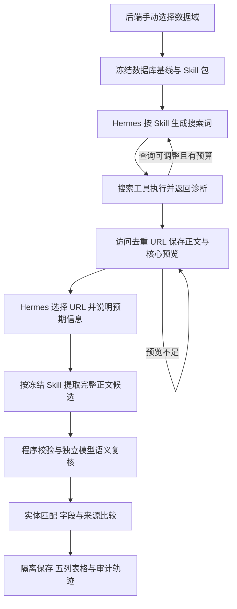

# Hermes 按数据域开放发现与持续更新设计

日期：2026-10-08（Asia/Shanghai）

状态：待用户审阅；本文件不代表实现或验收已完成。

本次产出：设计 spec。没有 implementation plan，不启动代码实现或部署。

## 1. 已确认的需求与验收边界

项目需要以 Hermes、Skill、访问工具和确定性程序构成持续更新链路，实现新芯片发现、已有芯片字段更新、字段来源更新。六个数据域分别使用领域 Skill，以支持不同搜索策略、判断规则和未来更新频率。

用户已确认：本阶段验收完整隔离链路，包括开放发现、字段与来源候选、网页展示和后端手动运行。验收通过后才进入正式发布与心跳启用阶段。本 spec 设计未来接入边界，但不要求本轮启用正式库更新或定时任务。

验收主入口选择数据域，不要求指定芯片或字段。省略芯片时，从开放互联网寻找该域的信息，不遍历数据库内全部芯片。搜索得到的页面可以涉及新芯片或已有芯片；已有芯片更新是开放发现的自然结果。明确指定芯片时，保留定向查询能力。

本阶段所有新实体、字段候选、来源候选、判定和轨迹进入隔离工作区。正式数据库只提供一致性快照、现值与来源基线，不作为候选写入目标。界面必须明确候选尚未发布。

## 2. 现状与需要纠正的偏差

以下是本地仓库核查结果；不把安装脚本、任务标签或部署文档等同于服务器当前运行状态。

| 现状 | 设计要求 |
|---|---|
| 新主链路从 `.agents/skills` 安装六个 Skill，旧体系位于 `.hermes-skills` | 为 Hermes 主链路建立唯一权威源和明确安装清单 |
| 两个目录的 `chip-compute` 同名但流程与输出合同不同 | 消除安装覆盖；旧合同退出新主链路 |
| 不指定芯片时枚举全部已有芯片并附加发现单元 | 默认创建按域开放发现任务 |
| 可以通过 `--field` 缩小成单字段任务 | 正常入口的字段范围由数据域完整决定 |
| Hermes 生成查询和选择 URL，提取器只读取 Python 字段注册表 | 提取与语义复核也必须加载领域 Skill 规则 |
| 500 字预览只是正文开头截断 | 选取页面主体的可定位核心片段；信息不足可继续查看 |
| 选中的发现 URL 被计为新芯片候选 | 新芯片数量由实体识别与数据库匹配结果计算 |
| 校验检查格式、取值和引文存在，不证明引文支持字段 | 区分程序校验与模型语义复核 |
| Hermes 结果展示使用简化列表，旧五列表格仍保留 | 恢复五列对比，并提供真实的冻结基线 |
| 部分页面阶段状态固定显示完成 | 状态由实际产物和阶段结果派生 |

相关代码：

- `scripts/install_hermes_open_web_plugin.sh`：现有六域安装来源。
- `chip_model/pipeline/hermes_open_web_orchestrator.py`：Hermes CLI 调用。
- `chip_model/pipeline/hermes_open_web_state.py`：现有全芯片默认范围。
- `chip_model/open_web_tool_server.py`：搜索、预览、选择、提取与关联处理。
- `chip_model/pipeline/open_web_test.py`：字段注册表、通用提取器、程序校验、历史读取。
- `static/run-history.js`：旧五列对比与新 Hermes 展示。

本设计取代 2026-09-30 spec 中“省略芯片即全芯片遍历”的默认范围，以及依赖通用注册表完成领域提取的约定。此前设计中的隔离、快照复用和审计能力仍可复用。

## 3. 架构选择与职责

采用局部重构：复用现有 Hermes 启动器、三个访问工具、正文抓取与快照能力、模型接口适配和隔离存储；纠正入口、Skill 规则传递、实体识别、来源比较及展示。

不采用只修改提示词和界面的方案，因为它无法补齐实体识别与真实来源比较；不全面重写爬虫、数据库或推荐系统。

### 3.1 谁负责什么

| 组件 | 职责 | 不承担的职责 |
|---|---|---|
| Hermes | 按 Skill 动态生成查询，阅读预览，选择页面，决定是否补搜或继续查看 | 不直接写业务表，不生成不存在的 URL |
| 领域 Skill | 更新目标、字段边界、搜索策略、页面判断、提取与复核规则、失败条件 | 不保存密钥、机器地址或实现网络请求 |
| 工具服务 | 搜索执行、访问、安全检查、去重、快照、分页、预算、协议校验 | 不用固定模板替代 Hermes 搜索规划，不用关键词分数替代页面价值判断 |
| Skill 加载器 | 按明确清单加载并冻结规则、字段合同、公共参考与版本 | 不从网页决定加载文件或扩展权限 |
| 后端模型提取器 | 按冻结的领域规则从完整正文产生结构化候选 | 不再只依赖领域名和通用字段提示词 |
| 后端模型复核器 | 在独立模型调用中验证候选、实体、条件与证据的语义关系 | 不把程序格式通过等同于事实正确 |
| 确定性比较与存储 | 实体匹配、取值与单位校验、来源比较、基线、幂等保存与统计 | 不凭型号相似度决定芯片相同，不把冲突直接覆盖为更新 |
| 状态页 | 展示结果与轨迹，恢复五列表格 | 不启动本轮任务，不声称隔离候选已写正式库 |

### 3.2 本阶段提取运行方式

本阶段保留后端独立模型提取器，由 Hermes 提交页面选择后触发。提取器和复核器必须读取同一冻结 Skill 包，分别执行 `extract` 与 `review` 阶段规则。每次模型请求记录领域、阶段、规则哈希和正文范围。

这两个阶段不是 Hermes CLI 亲自读取全部正文。验收材料明确写为“后端模型按领域 Skill 提取/复核”，不能标注为“Hermes 已调用另一个 Skill”。选择此方式是为了复用已经存在的完整正文提取能力，并让证据读取、候选格式和重试边界可控。

关联域也经过相同加载、提取和复核入口。仅变更注册表或模型提示词中的 Skill 名称不满足要求。

## 4. Skill 权威源、安装与使用证据

### 4.1 唯一来源

六个主 Skill 的权威源为 `.hermes-skills/<skill>/`：

```text
.hermes-skills/
  chip-identity/
  chip-specs/
  chip-compute/
  chip-compatibility/
  chip-benchmark/
  chip-deployment/
```

每个包包含 `SKILL.md`、机器可读的 `domain.json` 和领域参考。公共工具合同、证据规则与来源规则放在公共参考目录，由加载器按安装清单纳入 Skill 包。`domain.json` 定义领域 ID、标签、规则版本、目标表、字段所有权、实体键、单位约束；不含搜索模板或页面相关性评分。

`SKILL.md` 规定领域操作，并引用该合同。安装检查要核对文档中的字段归属和合同一致；程序白名单从同一合同生成，不再维护另一份独立的业务字段表。

`.agents/skills` 中供 Codex 使用的六域副本从权威源同步生成并校验哈希，不作为 Hermes 安装源，不允许两份手工维护。运行时仍从 `$HERMES_HOME/skills` 加载安装副本。

一次任务开始时冻结六域规则、公共参考和合同，分别供 Hermes 与后端模型使用。任务中途修改 Skill 不影响该任务；续跑继续使用原版本。缺少规则包、安装版本不匹配或必需参考不可读时，运行在进入模型阶段前失败。

### 4.2 旧 Skill 的处置

旧队列合同的 Skill 进入 `docs/archive/hermes-skills/` 并退出新主链路的自动安装清单。保留历史阅读与旧记录解释能力。旧 `chip-compute` 必须先与新权威包分离，不能依赖安装顺序解决覆盖。

| 现有 `.hermes-skills` Skill | 本设计定位 |
|---|---|
| `chip-catalog` | 归档旧队列入口；身份、类型和生命周期规则迁入 `chip-identity` |
| `chip-basic` | 归档旧入口；SKU、单位和单卡规则迁入 `chip-specs` |
| `chip-compute` | 旧合同归档；新权威 Skill 保留同名，但仅有一份可安装来源 |
| `chip-interconnect` | 归档旧入口；方向、聚合和接口规则迁入 `chip-specs` |
| `chip-ecosystem` | 归档旧入口；明确支持声明规则迁入兼容域；成熟度等扩展字段本轮不覆盖 |
| `chip-price` | 归档，价格更新不在六域本轮范围 |
| `benchmark-ingest` | 归档旧入口；完整测试条件与指标规则迁入 `chip-benchmark` |
| `deployment-ingest` | 归档旧入口；规则分入 `chip-compatibility` 和 `chip-deployment` |
| `url-discovery` | 归档旧队列入口；真实出链选择规则作为领域参考，不能被当作开放搜索 Skill |
| `data-quality-review` | 归档未完整接通的旧入口；本轮领域复核使用完整候选与证据输入 |
| `data-update-orchestrator` | 归档旧队列协调合同；不唤醒旧正式队列 |
| `data-update-orchestrator-test` | 归档旧三域测试合同；本轮使用新六域隔离入口 |
| `data-update-orchestrator-local` | 归档旧专用入口 |
| `aishperf-data-heartbeat` | 归档旧来源直写合同，本轮不安装或启用 |
| `source-refresh` | 归档旧巡检解释合同；页面变化检测程序可复用，但任务标签不等于 Skill 加载 |
| `chip-enrich` | 归档旧人工写库工具，不能进入自动候选链路 |
| `model-catalog` | 作为独立模型 API 流程资料保留，不进入芯片六域安装清单 |
| `model-activity` | 同上，当前不宣称已接通 API Skill 执行 |
| `chip-recommend-cli` | 保留独立查询用途，不进入自动数据更新安装清单 |
| `chip-selector-agent` | 保留独立咨询用途，不进入自动数据更新安装清单 |

归档不删除服务器旧配置、不自动卸载人工工具、不启用任何旧定时任务。旧数据域任务与新合同不得交叉领取。旧安装器若仍保留，必须不能覆盖新六域。

### 4.3 如何证明 Skill 起作用

每个阶段保存：`domain_id`、`skill_name`、规则版本、源路径、已安装路径、Skill 包 SHA-256、公共参考哈希、合同哈希、执行者、模型、调用时间、阶段、输入正文/候选范围和结果。

分别展示“规则已加载”“阶段已执行”“阶段通过/拒绝/失败”。只有字段注册表切换、安装成功或任务 `skill_name`，不能作为 Skill 执行成功的证据。

## 5. 六个数据域与字段范围

正常入口每次选择一个数据域。其完整字段集合来自 `domain.json`，不要求用户另选字段。提供字段集合表示检查范围，不代表必须为所有字段产生值。

### 5.1 身份域 `identity` / `chip-identity`

目标表 `chips`。字段：`vendor`、`vendor_display`、`vendor_region`、`chip_series`、`chip_model`、`chip_type`、`usage`、`tier`、`release_date`、`production_status`、`eol_date`、`target_market`、`is_released`、`expected_release_date`。

必须区分芯片、板卡 SKU、系列、服务器与集群；GPU/NPU/DCU/TPU/MLU/ASIC 不能混写。未公开发布依据明确时，状态使用 `production_status="未公开发布"`、`is_released="0"`，不从版权年份、文章日期或传闻推断发布。

### 5.2 规格域 `specs` / `chip-specs`

目标表 `chips`。字段：`architecture`、`arch_codename`、`generation`、`process_node_nm`、`foundry`、`die_size_mm2`、`transistors_b`、`package_type`、`is_chiplet`、`vram_gb`、`vram_type`、`vram_bus_bit`、`vram_bw_gb_s`、`vram_clock_mhz`、`l1_cache_kb`、`l2_cache_mb`、`on_chip_sram_mb`、`base_clock_mhz`、`boost_clock_mhz`、`tdp_w`、`max_power_w`、`psu_w`、`power_connector`、`board_length_mm`、`board_width_mm`、`slot_width`、`form_factor`、`bus_interface`、`interconnect_bw_gb_s`、`interconnect_tech`、`network_interface`。

只接受明确的芯片或单卡口径。整机 PSU、整机总显存和集群网络指标不得迁入这些字段。带宽必须区分 bit/byte、单向/双向、单链路/单卡聚合；架构和制程本轮统一归规格域。

### 5.3 算力域 `compute` / `chip-compute`

目标表 `chips`。字段：`precision_support`、`precision_perf`、`compute_units`、`tensor_cores`、`rt_cores`、`shading_units`、`sm_count`。

精度逐项核验 FP64、FP32、TF32、BF16、FP16、FP8、FP4、INT8、INT4 等，不依据某一精度推断其他精度支持。峰值保留 Dense/Sparse、计算单元类型及 TFLOPS/TOPS 口径；使用现有可兼容字段格式，无法无损表达的口径保留在候选元数据并标明，不合并覆盖。

### 5.4 兼容域 `compatibility` / `chip-compatibility`

关系目标表 `chip_model_compatibility`：`compat_status`、`framework`、`precision`、`verified_at`、`notes`；`chip_model`、`model_id` 属于关系实体键。

另允许对 `chips` 的 `software_stack`、`compatible_frameworks`、`framework_compat`、`sw_stack` 提交有明确版本或范围的支持声明。不同表的字段合同分别限定，不能用一般框架支持生成任意芯片×模型关系。

`verified`、`vendor_claimed`、`community` 与证据强度一致。项目没有实际复现实测或相应可核验验证证据时，不能因厂商宣传升级为 `verified`。

### 5.5 实测域 `benchmark` / `chip-benchmark`

目标表 `chip_model_benchmarks`。实体与条件包括 `chip_model`、`model_id`、`suite_name`、`workload_type`、`chip_count`、`precision`；字段包括 `scenario`、`task`、`hardware_config`、`framework`、`batch_size`、`input_seq_length`、`output_seq_length`、`concurrency`、`prefill_throughput`、`decode_throughput`、`time_to_first_token_ms`、`inter_token_latency_ms`、`memory_peak_mb`、`throughput_tok_s`、`throughput_samples_s`、`tpot_ms`、`mfu_pct`、`gpu_hours`、`training_tokens_T`、`training_gpu_count`、`training_workload_type`、`test_date`、`notes`、`citation`、`evidence_level`、`methodology`、`reference_url`。

同一记录的测试条件必须属于同一行、配置或报告，不跨配置拼接；未给出的输入输出、batch、并发和精度保留未知，不采用常识默认值。理论、外推与实测明确区分；理论峰值不得作为实测指标。

### 5.6 部署域 `deployment` / `chip-deployment`

目标表 `deployment_guides`：`backend`、`notes`；`url`、`title`、适用 `chip_model`、`model_id` 和表内 `source_type` 作为记录身份与范围信息。

版本、启动命令、依赖和拓扑在 `notes` 及结构化候选元数据中保存，不创建业务表不存在的版本列。芯片、模型、后端、版本和适用范围不能相互拼接；页面命令作为资料展示，不执行。

### 5.7 明确未覆盖的字段

价格、云可用性、成熟度评分、自由生成的芯片介绍与市场评价，以及模型目录/API 更新不属于本轮范围。它们有旧 Skill 不代表新六域已覆盖。所有字段合同须与实际数据库列核对；本地数据库已有 `deployment_guides` 等扩展表，不能仅依据历史“五表”说明判断运行 schema。

公共来源元数据包括 `source_url`、`source_type`、`confidence` 等，不与业务表中的同名字段混淆。所有域可识别必要身份上下文，但身份候选的最终判定使用 `chip-identity` 规则。

## 6. 运行入口、范围和资源预算

### 6.1 入口语义

- `domain` 必选，值为上述六个稳定 ID。CLI 对外使用 `--domain`；工具内部可保留对应 Skill 名称。
- `chip` 可选。空值表示 `scope_type=discovery`；有值表示定向 `scope_type=chip`，允许查询数据库尚不存在的明确型号。
- 正常公开入口不接受单字段范围。旧 `--skill` 允许作为六域名称别名兼容，并给出映射说明；旧 `--field` 请求明确返回“请按数据域运行”，不静默忽略或暗中缩小范围。
- 旧单芯片/全芯片历史会话只读兼容。旧全芯片运行不能按新默认模式续跑；返回合同版本不同的明确说明，用户可查看历史或创建新运行。
- 新运行可用 `run_id` 续跑；任务范围、基线、规则包和已完成阶段保持不变。

默认不根据数据库行数生成任务，不自动把本轮识别的新型号扩展成全库遍历。数据库用于搜索后的实体匹配与来源比较。

### 6.2 有界运行

初始 10 条不同查询；最多 2 轮补搜，每轮最多 5 条新查询，总计不超过 20 条。每条查询最多接收 10 条结果；规范化后的主要候选最多 100 个，超出部分保留预算排除原因。进入主要候选集合的每个 URL 都必须有访问与选择结论。

未截取的原始检索记录数量与实际纳入预算的候选数量分开统计。不能把预算排除记录显示为 Hermes 语义拒绝，也不能宣称“访问了所有搜索结果”。

每轮运行默认总时限 1800 秒；单次网络请求与模型调用均有更短超时并受总预算限制。单个可重试操作最多重试 2 次，采用退避，不重跑已经完成的阶段。预算参数由后端配置确定，保存到 manifest；网页与 Skill 不能扩大额度。到达预算上限明确结束为部分完成或失败，不无限搜索。

### 6.3 合同与读取接口

新运行使用 `schema_version="hermes-open-web-v3"`。manifest 包含 `domain_id`、`skill_name`、`scope_type`、可选目标芯片、完整字段合同、规则包哈希、预算、阶段状态、前后基线摘要和各类计数。工具请求必须携带运行 ID 与合同版本，不能对 v1/v2 历史会话按 v3 合同提交。

保留 `GET /api/v1/data-agent/open-web-runs` 与 `GET /api/v1/data-agent/open-web-runs/{session_id}` 作为状态与产物读取入口。新运行列表的“终态”包括 success、no_findings、partial、failed、interrupted，不因新增状态漏掉记录。旧读接口按历史版本解释已有字段，不静默重写历史状态。

## 7. 主流程与工具合同



继续使用三个业务工具，不把每个确定性步骤拆成一个新工具。三个工具允许有合同明确的重复调用；删除“恰好各调用一次”的旧要求。

### 7.1 `open_web_search`

输入包含运行 ID、范围、领域、搜索轮次与查询数组；初始轮 10 条，补搜轮 1–5 条。每条包括查询、理由、语言和期望页面类型。

查询由 Hermes 生成，倾向短词组，通常英文不超过 6 个实词、中文 2–4 个短词组；协议上限 120 个字符。初始轮至少 3 条中文和 3 条英文，其余由领域判断安排。可以针对厂商产品目录、新闻、文档、论文、评测和代码仓库，但不默认固定全部厂商清单，不使用内部字段名或未确认规格。当前日期作为参考，不能给所有搜索强加年份而漏掉仍有效的资料。

响应包含各查询的结果、候选 ID、搜索源、耗时和诊断。空结果、连接失败、HTTP/反爬失败、解析失败、整批退化、重复或预算排除分别记录。搜索服务可以执行 `site:` 等约束和检查搜索源健康，不代替 Hermes 判断页面领域价值。

Hermes 读取诊断后决定缩短、改变语言、减少限定或补搜。网络失败不能汇总成“没有芯片信息”。没有明确型号的开放发现不能套用“必须命中某个型号代码”的批次门槛。

### 7.2 `open_web_preview`

`mode=initial` 时处理本轮尚未访问的主要候选；服务端不接受自造的候选 ID。保存正文快照、HTTP 状态、最终 URL、正文哈希、抓取时间、抽取方式与失败原因。PDF 与 HTML 采用相应解析方式，完整规范化正文用于证据。

向 Hermes 返回每页最多 500 个 Unicode 字符，字符限制不包含 URL、标题和访问元数据。优先选择产品主体、与领域有关的标题附近、规格表或测试段落；清除导航、脚本和模板噪声，保留片段在正文中的位置。片段必须来自实际正文，不用模型补写“摘要”，并标出是否截断及正文总长度。

`mode=detail` 允许 Hermes 对已访问页面查看更完整正文。每次最多返回 4000 字符，支持按快照 offset 分页；每个页面最多 3 次额外读取，受总预算限制。复用快照，不因预览不足重新抓取。Hermes 可据此选择页面；超出阅读预算仍不能判断时，以“信息不足”留痕，不按无关内容处理。

### 7.3 `open_web_submit_selection`

Hermes 为全部主要候选提交决定：候选 ID、选择结论、理由、预期获得的信息、初步实体线索、匹配类别和建议关联域。预期信息是查找目标，不是已确认字段值。

访问失败不能选择为可提取页面；预览或补搜未完成时允许继续进行相应工具调用。提交最终选择前，服务端核对每个候选都有访问记录和一个决定，范围与领域一致。

选中页面进入后端提取与复核状态机。工具先返回接收结果与当前处理状态；长处理不要求单次 HTTP 请求持有整个运行。启动器继续读取同一运行状态直到终态或运行超时，不能把“已接收选择”视为任务完成。

若首轮无可用结果，在预算内由 Hermes 补搜；预算耗尽时由服务端依据诊断结束运行，不要求伪造空候选的 URL 选择记录。

三个工具与后端状态读取均以运行 ID 和合同版本隔离，禁止跨会话串用快照或候选。网页正文、搜索结果和模型输出始终作为资料，不作为工具参数之外的执行指令。

## 8. 提取、关联与语义复核

### 8.1 Skill 包的阶段组织

每个 Skill 至少有 `plan`、`select`、`extract`、`review`、`complete` 五个可定位阶段；公共参考规定工具字段、来源枚举、候选结构和失败状态。领域规则写清适用对象、排除对象、实体键、字段证据要求、单位及条件、跨域路由、冲突处理和完成条件。

后端 `extract` 请求包含冻结的 Skill 正文与必需参考、合同、完整正文范围、页面来源、范围模式和可选芯片线索。不能只传领域标签和字段名。大页面按标题、表格和段落分块，保留表头与脚注；记录处理过和未处理的正文范围，禁止静默 `text[:60000]` 后宣称全文完成。

一页可以返回多个明确实体，每个实体单独带身份依据和字段列表。候选结构包含：

- 候选 ID、领域、目标表、实体键/临时实体 ID、适用 SKU/形态与关系条件。
- 字段名、原始值、规范化值、单位、转换说明。
- 请求 URL、最终 URL、来源类型、置信度、快照哈希与时间。
- 逐字证据、正文位置、支持该值的说明，以及相关表头/脚注。

身份信息与关系键单独建模，不把模型 ID、卡数或部署标题当作无实体的独立标量更新。某页没有该域事实可明确返回无结果，不为完成计数制造候选。

### 8.2 校验与复核的顺序

1. 程序检查合同、字段归属、取值、单位、证据在对应快照中存在、实体键与范围。
2. 对格式通过的候选，由独立模型调用按 `review` 规则读取候选及其原文上下文，判断证据是否支持值、实体与条件是否唯一、来源与证据等级是否正确。
3. 复核结果再次经过程序检查；复核器不能凭空改值后直接通过。提出修改时返回修正候选，修正内容也必须完成程序校验和一次复核。
4. 经程序校验与语义复核都通过，才计为 `validated`。独立调用降低同一次生成直接自评的问题，但不代表事实必然正确，隔离验收仍要抽查。

失败例：版权日期作发布时间；其他 SKU 的容量；服务器总功耗作单卡 TDP；不同表列拼成同一算力；稀疏峰值当稠密；厂商支持声明变成已验证；理论峰值当实测；原文虽存在但与值无关。

复核输入必须包含完整候选、证据上下文与已知实体基线，不沿用旧质量任务仅含 `scope/max_entities` 的空输入。复核失败或服务不可用不能降低为格式通过。

### 8.3 一层关联

Hermes 选择阶段与完整正文提取可以提示其他数据域；系统合并、去重并限定为六域中的其他域。关联任务复用同一快照，加载关联 Skill 的提取与复核规则，不新增搜索，也不继续派生关联任务。

每个 URL×关联域最多一个任务。页面涉及新芯片但不是身份域时，必要身份核验作为 `chip-identity` 一层关联任务执行；身份未确认之前，规格或关系可保存为临时实体候选，不能记为已识别新芯片。

关联失败独立计入失败与部分完成，不因主要域有一个字段通过而隐藏失败。界面将“主要域结果”和“关联域结果”分开统计。

## 9. 新芯片实体识别与关系候选

冻结的数据库快照是匹配基线，不是开放搜索对象清单。厂商、型号及板卡/容量/形态差异共同决定实体；大小写、空格和经过验证的厂商别名可以规范化，但后缀、容量与形态不能随意删除。

实体结果分为：

| 结果 | 处理 |
|---|---|
| `existing` | 唯一匹配已有实体，比较该实体字段与来源 |
| `new` | 厂商和具体型号有证据、身份复核通过且未匹配已有实体，形成新芯片候选 |
| `ambiguous` | 系列/SKU或已有别名关系不明，保留歧义与可能匹配，不能算新芯片 |
| `out_of_scope` | 整机、集群、非目标计算芯片等，明确拒绝 |

每个新实体有稳定临时 ID，字段和关系绑定此 ID，不编造正式行 ID，不更新名字相近的已有芯片。相同实体的多 URL 证据合并后计一个实体；新来源 URL 和新芯片数量分开。

芯片或完整模型 ID 不在库中的实测、兼容和部署关系，仍可保留有证据的关系候选，标记依赖未解析。本轮不为了通过关系校验创建无证据模型或自动启动 HF 更新；也不能因现有 Publisher 仅接受已有实体而丢弃开放发现结果。

实测比较键包含芯片/SKU、模型、套件、工作负载、卡数、精度及已知 batch、输入输出、并发、框架、硬件配置和测试时间。关键条件缺失、现有记录多义时，不覆盖已有测试记录。部署候选按真实文档 URL、标题和明确适用范围识别；兼容关系保留支持范围与证据级别。

## 10. 字段与来源比较

### 10.1 不可变基线

一次运行开始时通过 SQLite 一致性备份建立隔离快照，冻结现值、对应现值的字段来源和实体信息。所有比较依据该快照，不在查看历史时改读最新正式库来伪造“当时旧值”。新实体显示“本轮基线无此实体”，与已有实体字段为空区分。

历史记录缺少基线时明确显示“旧值未记录”；只能额外标注当前参考值，不能将其冒充历史旧值。

### 10.2 值变化与来源变化分别记录

`value_change_kind` 包含 `new_entity`、`added`、`changed`、`unchanged`、`unknown`。`source_change_kind` 包含 `added`、`upgraded`、`conflict`、`unchanged`、`unknown`；两者是独立维度。

比较使用明确的规范化规则并保留原值。合法单位换算或大小写差异不直接认定值变化。值不同只说明候选与基线不同，不意味着基线必然错误或已经更正。

来源新增：规范化 URL 未在本实体本字段的来源中出现，或同 URL 有新的实际支持证据。来源改善：有明确更直接的一手证据或更完整的型号/条件支持，记录理由；不能只因模型写了 `high` 就提升等级。来源冲突：新旧证据无法解释为同一口径，保留双方证据并标记冲突，不自动选择新网页覆盖旧来源。

同 URL、同快照、同实体字段的重复候选幂等合并；同一字段多来源不计为多个独立字段更新。摘要分别报告新实体、独立实体字段、来源候选、URL 与被拒绝候选数量。

### 10.3 隔离存储与溯源

本轮只写隔离控制表、候选表与运行产物，业务表基线保持冻结；不在本轮模拟成正式发布。每个候选、判定、变化与来源关联均有审计记录。核心业务表没有实际写入时，不伪造 `field_provenance` 写入数。

未来正式发布或明确开展隔离业务写入验证时，所有实际业务字段写入与来源更新必须通过统一数据库接口并产生 `field_provenance`；新实体创建、仅来源改善和事务回滚的语义须另行通过发布阶段设计验收。

### 10.4 可审计运行产物

每个运行在 `data/test_runs/<run_id>/` 保存 manifest、隔离基线 `data.db`、冻结规则包 `skill_bundle/`、正文快照 `source_snapshots/`，以及搜索计划、原始检索记录、URL 预览、选择决定、实体候选、字段候选、来源候选、基线、语义复核、关联任务、模型使用与工具轨迹。JSONL 每条记录携带稳定 ID、阶段、时间、领域及引用快照/候选 ID。

读取接口与页面基于同一组产物生成结果，不用终端输出尾部推断成功。候选变更追加判定记录，冻结基线和原始证据不被覆盖。导出的运行 JSON 不包含密钥，保留用于验收的预算、规则哈希和证据关联。

## 11. 状态、失败、幂等与恢复

阶段包括 `preparing`、`planning`、`searching`、`previewing`、`selecting`、`extracting`、`reviewing`、`comparing`、`completed`。阶段结果按实际执行记录派生，包含未执行、执行中、完成、部分失败、失败、预算停止。

整体终态区分：

- `success`：计划范围处理完毕，必需阶段成功；包含明确、可解释的无变化结果。
- `no_findings`：有效搜索与判定完成，但没有有效领域候选，不等于搜索服务不可用。
- `partial`：部分阶段/页面/关联任务成功，但有未处理、失败、证据读取预算耗尽或正文范围未完成。
- `failed`：无法完成必要链路、全部搜索服务不可用或必需模型/规则包失败。
- `interrupted`：运行中止，可按检查点续跑。

是否有候选和执行是否完整是独立信息；例如有通过候选但多个搜索请求失败，仍必须披露覆盖不足并按未完成范围决定整体状态。

每个调用保存请求 ID、阶段、轮次与 payload 哈希。同一请求与 payload 返回已保存结果；同一请求 ID 不同 payload 返回冲突。断线重试不重复抓取、生成候选或追加决定。后端提取/复核有可恢复阶段记录，恢复时只处理未完成页面/实体，不能先写选择记录后永久卡住，也不能重置阶段而阻止读取已有结果。

不同候选的失败不吞掉其他结果。错误说明含阶段、搜索源或模型、错误类别与可恢复状态，过滤密钥等敏感内容。不可达页面与模型失败不作为“无相关信息”处理。

## 12. 结果展示与图二恢复

运行卡片展示数据域、开放发现/定向范围、开始结束时间、整体状态、搜索/URL/新实体/独立字段/来源候选计数及正式库未发布标记。数据域使用中文业务名称；技术 Skill、模型和哈希在详细记录中查看。

默认展开“字段提取与校验”，恢复以下五列：

| 列 | 内容 |
|---|---|
| 实体 / 字段 | 完整型号、厂商、适用 SKU 或关系条件、目标表字段、候选 ID、所属数据域 |
| 原值与原来源 | 冻结基线、基线时间、支持该旧值的来源与等级；新实体或缺失历史基线明确说明 |
| 候选新值与新来源 | 规范化候选值、原始值/换算说明、来源链接、来源类型与置信度 |
| 原文证据 | 支撑值的引文、必要表头/脚注、正文位置及快照引用 |
| 变更与状态 | 值变化、来源变化、程序校验与语义复核结论、拒绝/冲突理由，以及“已保存到隔离区，未发布” |

新芯片以真实实体卡片展示厂商、型号、依据和字段，不把页面标题作为芯片实体。支持按实体、数据域、值变化、来源变化与审核状态筛选。规范化候选通过与实际正式更新明确区分。

搜索词、来源诊断、候选 URL、访问结果、500 字预览、Hermes 决定、模型阶段、关联任务和工具记录收进“详细记录”。阅读时刷新保留展开状态、筛选和位置。旧运行使用原版本适配，缺少数据明确显示，不伪造基线、复核状态或完成阶段。

## 13. 搜索核验与验收标准

### 13.1 搜索环境核验

在实际 Hermes 与工具服务运行环境，用同一组短中英文探针分别检查 Bing、360 与 DuckDuckGo 等已配置搜索源，记录请求查询、HTTP/网络结果、解析结果、有效 URL 和代理配置是否生效。网络与解析诊断不包含密钥。

探针是诊断材料，不是日常生产的固定搜索模板。保留模型原始生成查询与实际请求查询，确保搜索工具没有改错词。明确型号的定向查询与无型号的开放查询分别测；不得以单颗 H100 成功证明开放发现或六域搜索都可靠。

### 13.2 行为验收

| ID | 必须满足的结果 |
|---|---|
| A01 | 不指定芯片启动一个域级发现运行；任务数不随数据库芯片数增加 |
| A02 | 指定已有或库外芯片仍可定向查询；字段集合由域决定，旧单字段参数明确拒绝 |
| A03 | 六个主 Skill 的权威源、安装副本与冻结包一致；旧同名包不能覆盖 |
| A04 | Hermes 的搜索词、预览选择，后端提取与复核都有对应规则包与阶段使用证据 |
| A05 | 搜索失败能区分网络、空结果、解析和退化；Hermes 在预算内调整查询，程序不代替生成 |
| A06 | 去重后的主要候选都有访问和选择结论；预算排除与语义拒绝分开 |
| A07 | 单页预览最多 500 字，来自正文主体并可定位；不足时可读取更完整快照 |
| A08 | 单页多实体不会串字段；只有身份证据和匹配通过的实体计入新芯片 |
| A09 | 库外芯片与模型关系保留临时实体/依赖候选，不伪造正式 ID |
| A10 | 错 SKU、版权日期、整机指标、错算力口径、无关引文和不完整测试条件有明确拒绝或未解析结果 |
| A11 | 值相同但新来源或更好来源仍产生来源候选；重复 URL/证据不重复计为独立字段 |
| A12 | 五列界面恢复；历史缺基线不冒充现值；阶段不硬编码完成 |
| A13 | 中断续跑、重复提交和关联失败有正确记录，不重复生成或隐藏结果 |
| A14 | 正式库无业务写入、无定时任务启动；隔离候选与正式发布明确区分 |

### 13.3 验证证据要求

自动化回归覆盖上述正常流程、边界与失败路径，并完成项目要求的 `python -m pytest -q`。界面用有真实基线、来源变化、拒绝和新实体的隔离样例做浏览器检查。

可控网页/搜索样例验证正向新芯片识别及错误证据拒绝，但不能冒充开放互联网实测。实际环境中，六域各完成一次不绑定芯片的 Hermes 冒烟，保存真实查询、网络结果、规则加载、访问、判定和字段结果。没有发现新芯片可如实记录，但不能将其作为正向识别能力唯一证据。

验收人工抽查每域最多 5 个最终通过候选：不足 5 个时检查全部；另核对已产生的拒绝、来源变化和新实体候选。页面、运行 JSON、快照和轨迹能够相互对应。模型耗时、调用数、覆盖不足和失败都可见，不把一个模型生成的候选数量作为准确率。

正式库一致性不能仅检查 SQLite 主文件而漏掉 WAL。验收在无其他写入者的窗口进行，核对正式业务表、`field_provenance` 和 SQLite 一致性快照摘要的前后状态；若有其他写入者，记录干扰并重做受控核验，不把外部写入归因于本链路或以主文件哈希相同宣称未修改。

## 14. 未来发布与心跳的接口边界

本轮提供按域的运行状态、候选、来源比较与规则版本，作为以后心跳调度和 Publisher 的输入。六域更新间隔由独立调度配置管理，不沿用旧 Skill 注册表中不一致的频率。具体间隔在启用阶段根据耗时、成功率和信息变化率决定，本轮不保存或启用调度值。

未来心跳应触发同一条域级主链路，优先续跑未完成任务，防止同域重叠；不能恢复“已知链接先抓完再唤醒旧队列”的旧主流程来替代开放发现。平稳或无结果时不反复通知，只在有意义变化、完成、失败或需要用户处理时通知。

正式发布须另外验收新芯片创建、关系依赖解析、字段与仅来源更新、影子测试、备份、事务、溯源和回滚。当前 spec 不授权自动发布或启用现有历史心跳。

## 15. 设计评审焦点

本设计选择了唯一 Skill 权威源、按域默认开放发现、三个工具的有界重复调用、后端按完整 Skill 提取与独立复核、只保存隔离候选及五列表格恢复。六域字段边界和旧 Skill 归档是设计的一部分，不只是界面命名调整。

用户审阅本 spec 后才能进入下一阶段。本次不生成 plan，不执行代码、Skill 迁移、服务器部署、数据库更新或心跳配置变更。
